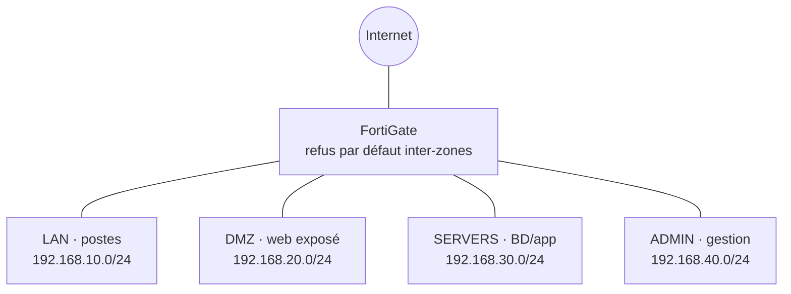

# fortigate-segmentation — Segmentation réseau d'entreprise (FortiGate)

Conception d'une **segmentation réseau d'entreprise par pare-feu FortiGate** : quatre
zones isolées (LAN, DMZ, SERVERS, ADMIN) et des politiques inter-zones en **moindre
privilège**, justifiées règle par règle. Tout est **refusé par défaut** ; seuls les flux
nécessaires sont ouverts.

> **Statut : conception documentée, preuves à capturer.**
> L'architecture, la matrice de flux et un extrait de configuration modèle sont fournis.
> Aucune VM FortiGate n'étant disponible pour l'instant, la config exportée réelle et les
> captures restent à produire : voir [`captures/TODO-PREUVE_config.md`](captures/TODO-PREUVE_config.md).
> **Aucune capture d'écran n'est inventée dans ce dépôt.**

## Architecture



Détail des zones et de l'adressage : [`topology/README.md`](topology/README.md).

## Matrice de flux (moindre privilège)

Chaque flux autorisé est justifié ; tout le reste est refusé et journalisé. Extrait :

| Source | Destination | Service | Décision | Justification |
|---|---|---|---|---|
| LAN | WAN | HTTP/HTTPS, DNS | ✅ | Navigation web des utilisateurs |
| WAN | DMZ | HTTPS | ✅ | Publication du serveur web |
| DMZ | SERVERS | port back-end précis | ✅ | Le web interroge la base, un seul port |
| DMZ | LAN | — | ⛔ | Un serveur exposé n'initie jamais vers les postes |
| ADMIN | toutes zones | SSH/RDP/HTTPS | ✅ | Administration hors-bande dédiée |
| toutes | ADMIN | — | ⛔ | Zone d'admin injoignable depuis la production |
| toutes | toutes (non listé) | any | ⛔ journalisé | Deny implicite par défaut |

Matrice complète : [`policies/matrice_flux.md`](policies/matrice_flux.md).

## Configuration

Extrait de configuration FortiGate **modèle et anonymisé** (objets d'adresse, groupes de
services, politiques) : [`policies/policy.sample.conf`](policies/policy.sample.conf).
La configuration exportée d'un équipement réel devra être **anonymisée** (IP publiques,
mots de passe, secrets VPN masqués) avant d'être ajoutée.

## Points d'attention

- **Journalisation** : activer le log du trafic autorisé et du deny implicite
  (`fwpolicy-implicit-log`) pour repérer les flux anormaux.
- **NAT** : uniquement en sortie WAN ; pas de NAT entre zones internes.
- **Administration hors-bande** : gestion du pare-feu et des serveurs depuis `ADMIN` seulement.
- **DMZ cloisonnée** : isoler strictement la DMZ des zones internes.

## Structure du dépôt

```
topology/   architecture, zones, plan d'adressage
policies/   matrice de flux + configuration modèle anonymisée
captures/   config exportée réelle + captures (ou TODO-PREUVE_*.md)
```

## Licence

[MIT](LICENSE) — © 2026 HARCHOUNE Abdellah
