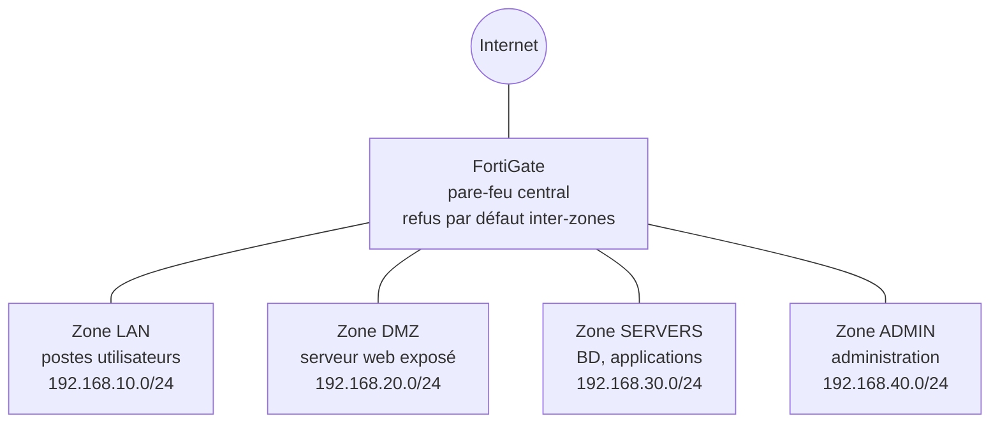

# Architecture et plan d'adressage

Un pare-feu **FortiGate** central segmente le réseau d'entreprise en quatre zones
isolées. Tout flux inter-zones passe par le FortiGate et est **refusé par défaut** :
seuls les flux explicitement nécessaires sont autorisés (moindre privilège).

## Zones et adressage

| Zone | Rôle | Sous-réseau | Interface FortiGate (ex.) |
|---|---|---|---|
| `LAN` | Postes de travail utilisateurs | 192.168.10.0/24 | port2 |
| `DMZ` | Serveur web exposé sur Internet | 192.168.20.0/24 | port3 |
| `SERVERS` | Serveurs internes (base de données, applicatifs) | 192.168.30.0/24 | port4 |
| `ADMIN` | Réseau d'administration (accès aux équipements) | 192.168.40.0/24 | port5 |
| `WAN` | Accès Internet | — | port1 |

Les numéros d'interface et adresses sont des exemples : les ajuster au matériel réel
(voir `captures/TODO-PREUVE_config.md`).

## Principes

- **Refus par défaut** : aucune règle « any/any ». La dernière règle implicite bloque et journalise.
- **Administration hors-bande** : la gestion du FortiGate et des serveurs se fait depuis
  la zone `ADMIN` uniquement.
- **DMZ cloisonnée** : un serveur compromis en DMZ ne doit pas pouvoir atteindre `SERVERS`
  ni `LAN` (seuls les retours de connexions établies sont permis).
- **Journalisation** : toutes les règles autorisées et le deny implicite sont journalisés.
